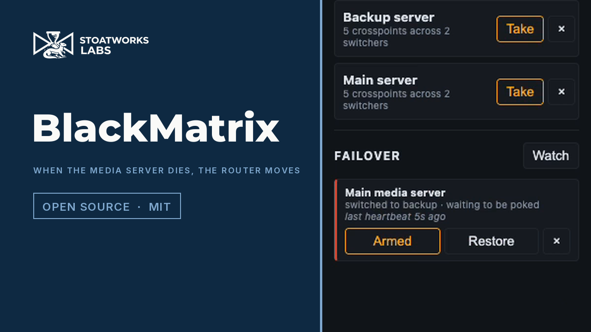

# BlackMatrix

> **AI-assisted project.** This codebase was created with [Claude Code](https://claude.com/claude-code)
> (Anthropic), directed and reviewed by a human author. I built it against a simulated
> switcher fleet (`--mock`) and a real TCP client speaking the Videohub protocol, then
> **checked it against a real ATEM Mini Extreme ISO**, which corrected the routing rules
> rather than confirming them: the availability masks were probed on the hardware, and this
> app's matrix was served from it as a 29x39 router. On **2026-10-04 it ran a live show**
> (v0.3.4) with a real Smart Videohub 12G 40x40 as one of its devices, beside an ATEM 4 M/E
> Constellation 4K, and held up. What has **never** happened is a real Videohub control panel
> driving it. Prove it on your own kit before it goes anywhere near a show.

A crosspoint router matrix for a fleet of Blackmagic ATEM switchers: sources across the
top, destinations down the side, one click to route. It also pretends to be a Blackmagic
Videohub, so hardware router panels, Companion and Blackmagic's own software can drive the
same crosspoints, and on a redundant rig a media server can switch to its backup machine
through it.

[](https://www.youtube.com/watch?v=A0YzfXbPcG0)

*Fifty-three seconds, filmed against a released build and its simulated fleet. The
failover at the end fires because the heartbeat actually stopped and the app's own state
machine noticed, and the crosspoints move because a salvo was taken, not because the video
was edited. The only staging is that two of the switcher's cameras are renamed to stand in
for the media servers.*

You can click around it yourself at <https://blackmatrix-demo.stoatworks-labs.com>. That's
the matrix itself in your browser, driving a simulated fleet you build from the device
library. Every device there is made up inside the tab, so nothing's on a network and
nothing's being controlled. **A web page can't reach a switcher at all**: the ATEM protocol
is UDP, the Videohub protocol is raw TCP, and a browser can open neither. To route actual
hardware, run the app on the show network.

An ATEM doesn't have a single "router", so BlackMatrix treats every bus that takes one
source at a time as a destination, grouped into sections:

| Section | Destinations | Routed with |
|---|---|---|
| **Outputs** | Aux 1..n | `setAuxSource` |
| **Program / Preview** | Program and Preview per ME | `changeProgramInput` / `changePreviewInput` |
| **Keyer sources** | USK fill and key per ME, DSK fill and key | `setUpstreamKeyer*Source` / `setDownstreamKey*Source` |
| **SuperSource** | Box 1..n, art fill, art key | `setSuperSourceBoxSettings` / `setSuperSourceProperties` |
| **Multiview** | Every multiviewer window | `setMultiViewerWindowSource` |

Which sources are legal on which destination comes from the switcher, not from a table of
models: every ATEM input reports a `sourceAvailability` mask (aux, multiviewer, SuperSource
art, SuperSource box, key source) and a `meAvailability` mask. Illegal cells are drawn
hatched and the server refuses them, so you can't route an aux output back onto an aux bus,
or ME 1's output onto ME 1.

## Quick start

```bash
npm install
npm run dev:mock
```

That serves <http://localhost:8533> with three simulated switchers, each a different shape
on purpose (1 M/E, 4 M/E, compact), and a Videohub server for each one. There's no hardware
and nothing on the network, so there's nothing to break.

For real switchers, write a `blackmatrix.config.json` (there's an example in
`config/blackmatrix.config.example.json`) and run:

```bash
npm run build && npm start
```

<!-- downloads:start -->

## Download

**[v0.4.2](https://github.com/stoatworks-labs/blackmatrix/releases/tag/v0.4.2)** — prebuilt for macOS, Windows and Linux. Pick your platform:

<details>
<summary><b>macOS</b> — Universal (Apple Silicon + Intel)</summary>

| Build | Download | Size |
| --- | --- | --- |
| Universal (Apple Silicon + Intel) · .dmg disk image | [`blackmatrix-0.4.2-macos-universal.dmg`](https://github.com/stoatworks-labs/blackmatrix/releases/download/v0.4.2/blackmatrix-0.4.2-macos-universal.dmg) | 89 MB |
| Universal (Apple Silicon + Intel) · .pkg installer | [`blackmatrix-0.4.2-macos-universal.pkg`](https://github.com/stoatworks-labs/blackmatrix/releases/download/v0.4.2/blackmatrix-0.4.2-macos-universal.pkg) | 89 MB |

</details>

<details>
<summary><b>Windows</b> — x64</summary>

| Build | Download | Size |
| --- | --- | --- |
| x64 · .exe installer | [`BlackMatrix_0.4.2_x64-setup.exe`](https://github.com/stoatworks-labs/blackmatrix/releases/download/v0.4.2/BlackMatrix_0.4.2_x64-setup.exe) | 30 MB |

</details>

<details>
<summary><b>Linux</b> — x64</summary>

| Build | Download | Size |
| --- | --- | --- |
| x64 · .deb package (Debian/Ubuntu) | [`BlackMatrix_0.4.2_amd64.deb`](https://github.com/stoatworks-labs/blackmatrix/releases/download/v0.4.2/BlackMatrix_0.4.2_amd64.deb) | 57 MB |
| x64 · .rpm package (Fedora/RHEL) | [`BlackMatrix-0.4.2-1.x86_64.rpm`](https://github.com/stoatworks-labs/blackmatrix/releases/download/v0.4.2/BlackMatrix-0.4.2-1.x86_64.rpm) | 57 MB |

</details>

All builds, checksums and release notes: [github.com/stoatworks-labs/blackmatrix/releases](https://github.com/stoatworks-labs/blackmatrix/releases).

macOS builds are signed and notarised and open normally. The Windows builds are unsigned, so SmartScreen warns once.

<!-- downloads:end -->

## Videohubs, not just switchers

A real Blackmagic Videohub can join the same fleet as a device:

```jsonc
{ "id": "hub", "name": "Machine room", "type": "videohub", "address": "192.168.1.60" }
```

Its inputs become sources and its outputs become destinations in the same grid, so one
screen covers the switchers and the router between them, and a salvo can reach both. Locks
on a Videohub belong to the router and are shared with every other client on it. The
details, and the **ties** that make an ATEM bus and a router output follow each other, are
in [docs/videohub.md](docs/videohub.md).

**Wiring** (new in v0.4.0) is where you write down how the router and the switchers are
cabled (router outputs into switcher inputs, switcher auxes back into the router), because
nothing on the network knows. Once you have, a cabled input tells you what it's actually
carrying, and **Route through** takes a router input straight to a switcher bus, or a
switcher output through the router to a screen. It plans the crosspoints, lists everything
else they'd change, and sends them upstream first, stopping at the first refusal. So far
it's only run against the simulated fleet. The
[user guide](docs/USER-GUIDE.md#wiring-and-routing-through-the-router) has the rest.

## Capture a switcher before you lose it

```bash
npm run capture -- 192.168.10.240 --name "Stage"
```

The availability masks this whole project depends on only exist in the protocol. They're
not in an ATEM autosave or in any other file a switcher leaves behind, so when the switcher
goes back on the van, its shape goes with it. A capture puts a real switcher's shape on
disk, and `"capture": "<file>"` on a device replays it with no hardware present. See
[docs/capture.md](docs/capture.md), which also covers the opt-in probe that tests the masks
against the hardware.

## Adding devices

The **Devices** page (top right) is where you add, edit, reconnect and remove switchers and
routers, without a config file or a restart. **Scan network** sweeps the local /24s for both
kinds and offers what it finds. A switcher answers on UDP 9910, a router on TCP 9990, and
neither answers the other's probe.

Ports for the Videohub emulation are handed out from `basePort` upward and written back to
the config, so they stay put when devices come and go. A panel is set up against a port
number, and that number belongs to the device, not to wherever it happens to sit in a list.

You can't change a device id once it's made, because salvos, ties and label overrides are
all keyed on it. Removing a device leaves the salvos and ties that mention it alone rather
than rewriting them, and tells you which ones. If you pull a switcher out for an hour, you
should get your salvos back when it returns.

## On a phone

The web UI is responsive. Below 800px the grid turns into an X-Y panel: a list of
destinations showing what each one's taking, then the sources that destination will accept.
You don't get a smaller grid, because a grid doesn't shrink, and hardware panels work this
way for the same reason. **Preset is the default at that width**, so a stray thumb stages a
route instead of cutting it.

That works in any phone browser pointed at the server. There's also a native iOS app in
`mobile/`, which adds the one thing a browser can't do: **finding the server without typing
an address**.

```bash
cd mobile
npm install
npm run ios:init      # once, generates the Xcode project
npm run ios:build     # or: npx tauri ios build --debug --target aarch64-sim
```

It's only a shell, on purpose. It sweeps the local /24s for BlackMatrix servers, remembers
the ones you use, and then shows the server's own UI. It doesn't speak the ATEM or Videohub
protocols: a phone has no business holding a switcher connection open while the OS suspends
it, and the panel emulation needs a listening socket. Both of those stay on the server.

Android builds too (`npm run android:init`, then `npm run android:build`). It needs
`ANDROID_HOME`, `NDK_HOME` and a `JAVA_HOME` pointing at **JDK 21**. Gradle can't use JDK
25, and the only way it tells you is a bare `> 25.0.4`, which is about as helpful as Gradle
gets.

Neither mobile app has run on a physical device yet. That needs an iOS development profile
and an Android release key, which are credentials rather than code.
[docs/signing.md](docs/signing.md) has the steps, and the build wiring for both is already
in place.

## The hosted simulator

```bash
npm run sim          # locally, on :5183
npm run sim:build    # static build in packages/web/dist-sim
```

This is a build of the same UI that simulates its devices in the browser tab, with a model
list covering the ATEM and Videohub ranges. It's a demo and says so on every screen. Nothing's
on a network and nothing's being controlled, because no web page can reach this hardware:
the ATEM protocol is UDP, the Videohub protocol is raw TCP, and the emulation this app offers
panels has to *listen* on a port. A browser can't do any of those.

The simulator doesn't reimplement anything. It builds a real `AtemState` and runs it through
the same matrix model, legality rules and grid as the live app, so what it shows is what the
app would show. What it can't be is *accurate about a model*. The names are Blackmagic's, but
only the entries marked as read off hardware carry real numbers. Everything else is a rough
shape for that class of device, and a capture replaces it with the truth.

## Configuration

```jsonc
{
  "port": 8533,                                   // UI + REST
  "videohub": { "enabled": true, "basePort": 9990, "host": "0.0.0.0" },
  "devices": [
    { "id": "stage", "name": "Stage", "address": "192.168.10.240" },
    { "id": "studio", "name": "Studio", "address": "192.168.10.241", "videohubPort": 9995 }
  ],
  "labels": { "stage": { "aux.0": "FOH screens" } },  // your names for destinations
  "salvos": []
}
```

Each switcher gets its own Videohub server: the first on `basePort`, the next on
`basePort + 1`, and so on, unless you set `videohubPort`. **If something else on the host is
already listening on 9990** (Bitfocus Companion's Videohub panel surface does), the switcher
affected logs the clash and starts without it, and everything else carries on. Give it
another port.

## Controlling it from a router panel

Point any Videohub client at `<host>:<port for that switcher>`:

- **Bitfocus Companion**, with the `blackmagic-videohub` module.
- **A Smart Videohub / Universal Videohub hardware panel**, or Blackmagic's
  Videohub Control software.
- **Anything else** that speaks [the Videohub Ethernet Protocol](docs/videohub.md).

Input numbers are the switcher's sources in ATEM source-id order, and output numbers are the
destinations in the section order of the table above. Both orders stay the same for a given
switcher, so a panel's buttons keep meaning the same thing.

The full mapping, what is and isn't implemented, and a worked telnet session are in
[docs/videohub.md](docs/videohub.md).

## Claims

A destination can be claimed, either with the flag on its row in the browser or with a lock
from a panel. They're the same thing, and `docs/videohub.md` calls it a lock because that's
what the wire calls it. Claims are held **per IP address**, the way a real Videohub does it,
so a second panel on the same machine shares one and everyone else is refused. Shift-click
the flag (or send `F` on the wire) to force one open.

It's all enforced in one place, so a claim made from a panel refuses a route made from the
browser, and the other way round.

**In the app it's a claim, and a claim stops you too.** The flag on each row claims that
destination: the row crosshatches, its crosspoints stop taking clicks, it can't be staged
into a take, and the flag is how you release it. That includes whoever made the claim. On
the wire an owner can route through its own lock, which is the spec and what panels get, but
the browser and the phone app *are* that owner, so a rule that only stopped other clients
wouldn't stop anyone who could see the button.

## Salvos

A salvo is a named set of crosspoints across the whole fleet, and one press sets them all.
Build one in the UI by capturing what destinations are taking right now (`Build new`, then
`+` on each row you want), or write them into the config file.

Every crosspoint in a salvo gets tried, and any the switcher won't accept come back named
rather than vanishing without a word. Salvos are this app's own idea and aren't part of the
Videohub Ethernet Protocol, so they only exist in the UI and the REST API.

## Redundant systems

A redundant media server rig is two machines playing the same show, and a router downstream
deciding which one gets to the screens. BlackMatrix can be that router, in either of the two
shapes the industry uses.

**The media server drives it.** disguise's understudy sends the matrix routing itself the
moment it takes over from a failed machine, and PIXERA fires a control action at a matrix
switcher from its `System Lost` trigger. Both can point at the Videohub emulation: disguise
has a Blackmagic Smart Videohub driver, and PIXERA will send anything over TCP. Because an
ATEM re-syncs its inputs, the main and backup feeds don't need to be genlocked to each other
for a clean cut, which an SDI router does need.

**Or this app decides.** A **failover watch** polls a machine (a TCP port, a URL, or a
heartbeat that has to keep arriving) and fires a salvo when it stops answering. It won't
fire until it's seen the machine working once, it starts disarmed, it only fires once, and it
doesn't switch back unless you tell it what "back" means. What it fires is an ordinary
salvo, so you can rehearse the failover by pressing Take on it.

**And a plain line protocol** on TCP and UDP (`ascii.enabled`, port 9995) for anything that
can send a string but can't speak Videohub, such as disguise's generic Telnet Matrix,
PIXERA's TCP module, 7thSense or a show controller:

```
ROUTE 2 1          route output 2 to input 1
1*2!               the same thing, Extron style
SALVO backup       fire a salvo by name
3.                 fire the third salvo (Extron preset recall)
FAILOVER main      fire a watch's lost salvo
```

There's one trap with locks worth knowing before you rely on any of this. A refused route
gets an `ACK` and an unchanged status, because the Videohub spec says so, which means **a
media server can't see a refusal**. A locked destination is a failover that silently doesn't
happen. `videohub.failoverClients` lists the addresses whose routes walk through locks.

All of it, including how to fill in disguise's and PIXERA's fields, is in
[docs/failover.md](docs/failover.md).

## REST API

| Method | Path | Body |
|---|---|---|
| `GET` | `/api/fleet` | — |
| `POST` | `/api/devices/:id/route` | `{ "destination": "aux.0", "source": 3 }` |
| `POST` | `/api/devices/:id/lock` | `{ "destination": "aux.0", "action": "lock\|unlock\|force" }` |
| `POST` | `/api/devices/:id/label` | `{ "destination": "aux.0", "label": "FOH" }` or `{ "source": 3, "label": "Wide" }` |
| `GET` `POST` | `/api/salvos` | a salvo |
| `DELETE` | `/api/salvos/:id` | — |
| `POST` | `/api/salvos/:id/take` | — |
| `GET` `POST` | `/api/failover` | a failover watch |
| `DELETE` | `/api/failover/:id` | — |
| `POST` | `/api/failover/:id/arm` | `{ "armed": true }` |
| `POST` | `/api/failover/:id/trigger` | — take over now |
| `POST` | `/api/failover/:id/restore` | — go back, clear the latch |
| `POST` | `/api/failover/:id/heartbeat` | — for a heartbeat probe |

The browser gets the same state pushed over `ws://<host>:8533/ws`.

Renaming a **source** renames the input on the switcher itself. Renaming a **destination**
only changes it in this app, because the ATEM doesn't have a name for "Aux 2".

## Layout

```
packages/
  videohub   @av/videohub      Videohub Ethernet Protocol v2.3, server AND client. Knows nothing about ATEMs.
  ascii      @av/ascii-matrix  The plain-text line protocol. Also knows nothing about ATEMs.
  matrix     @av/atem-matrix   Turns an AtemState into destinations, legal sources, and routing calls.
  server     @blackmatrix/server  Fleet, locks, salvos, failover, REST + websocket, one Videohub per switcher.
  web        @blackmatrix/web     The grid.
```

The three libraries are portable on purpose: `@av/videohub` will put a Videohub front end on
anything with crosspoints, `@av/ascii-matrix` will put a line protocol on it, and
`@av/atem-matrix` has no I/O in it at all.

## Known limits

- **No real Videohub panel has driven it.** The emulation side is verified against the
  published specification, a TCP client and an ATEM's own Videohub server, but not a panel.
  A real Videohub *as a device* has been through it: a Smart Videohub 12G 40x40, through a
  live show on 2026-10-04.
- **Wiring and Route through** (new in v0.4.0) have only run against the
  simulated fleet.
- **No media server has driven the failover support.** It's written from disguise's and
  PIXERA's documentation, and tested against this repo's own clients. The numbering is the
  first thing to check on real kit.
- The first two **multiview windows** aren't fixed to program and preview, whatever the
  received wisdom says: on the Mini Extreme ISO both took every source their masks allowed,
  so they're ordinary rows. Only the multiview windows were probed on that switcher, though.
  The aux buses' availability bits have never been checked against what an aux output did.
- **Media player still/clip selection isn't a destination, on purpose.** It takes from the
  media pool rather than the video sources, so it doesn't belong in a matrix whose columns
  are sources.
- The failover probes (a TCP handshake, an HTTP answer or a heartbeat) answer "is that
  machine there?", not "is it playing the right thing?". Knowing whether a media server's
  output is *correct* means speaking its protocol, which is a much bigger promise than this
  one makes.
- Streaming and recording follow program and can't be routed, so they're not in the grid.

## License

MIT, see [LICENSE](LICENSE).
