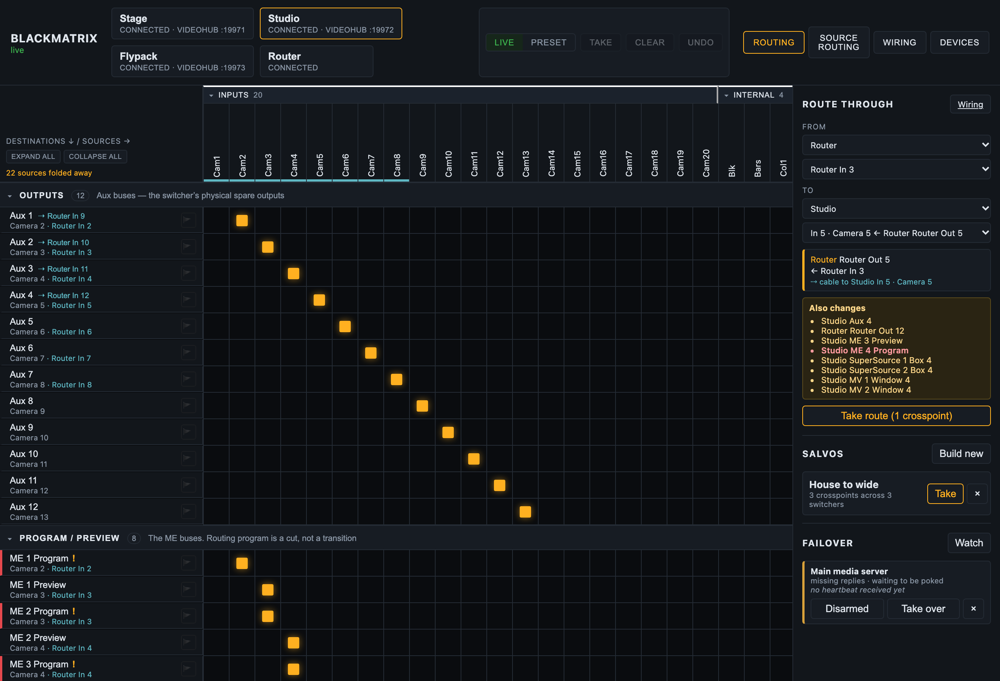
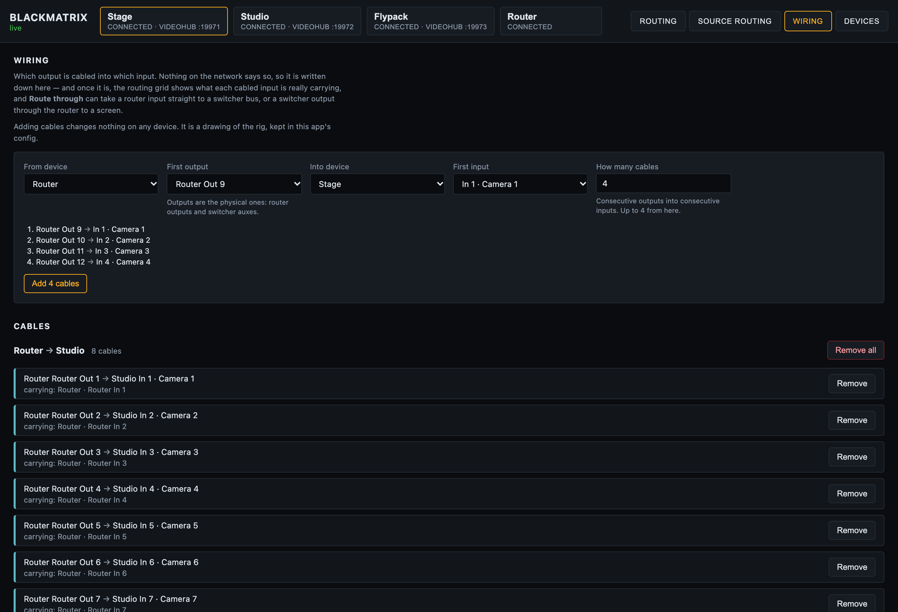

# BlackMatrix user guide

BlackMatrix is a crosspoint router matrix for a fleet of Blackmagic ATEM switchers: sources
across the top, destinations down the side, one click to route.



*The routing grid on the built-in mock fleet. The underlined inputs are cabled from the router, and each row says where its picture actually starts. On the right, Route through has planned a router input onto a switcher input and listed everything else it would change. The switcher state is simulated.*

It also pretends to be a Blackmagic Videohub, so hardware router panels, Companion and
Blackmagic's own software can drive the same crosspoints, and on a redundant rig a media
server can switch to its backup machine through it.

> **Before you rely on this:** I developed it against a built-in simulated switcher fleet and
> a real TCP client speaking the Videohub protocol, then **checked it against a real ATEM Mini
> Extreme ISO**, which *corrected* the routing rules rather than confirming them. The
> availability masks were probed on that hardware, and this app's matrix was served from it
> as a 29×39 router.
>
> On **2026-10-04 it ran a live show** with a real Smart Videohub 12G 40x40 as one of its
> devices, beside an ATEM 4 M/E Constellation 4K, and held up. **What has never happened is a
> real Videohub control panel driving it**, and neither mobile app has run on a physical
> device. Wiring and Route through are newer than that show and have only met the simulated
> fleet. Prove it on your own kit before it goes anywhere near a show.
>
> This codebase was created with AI assistance, directed and reviewed by a human author.

---

## The model: an ATEM has no router

So this treats every bus that takes one source at a time as a destination, grouped into
sections:

| Section | Destinations |
|---|---|
| **Outputs** | Aux 1..n |
| **Program / Preview** | Program and Preview per ME |
| **Keyer sources** | USK fill and key per ME, DSK fill and key |
| **SuperSource** | Box 1..n, art fill, art key |
| **Multiview** | Every multiviewer window |

**Which sources are legal on which destination is read from the switcher, not from a table
of models.** Every ATEM input reports availability masks. Illegal cells are drawn hatched and
the server refuses them, so you can't route an aux output back onto an aux bus, or ME 1's
output onto ME 1.

That's why a capture matters (see below).

---

## Getting started

```bash
npm run dev:mock
```

serves the UI on <http://localhost:8533> with three simulated switchers, each a different
shape on purpose, and a Videohub server for each one. There's no hardware and nothing on the
network, so there's nothing to break, and it's the right way to build a layout before you're
in the room.

For real switchers, write a `blackmatrix.config.json` and run `npm start`.

The **Devices** page adds, edits, reconnects and removes switchers and routers without a
config file or a restart. **Scan network** sweeps the local /24s for both kinds. A switcher
answers on UDP 9910, a router on TCP 9990, and neither answers the other's probe.

---

## Capture a switcher before you lose it

```bash
npm run capture -- 192.168.10.240 --name "Stage"
```

**The availability masks this whole project depends on only exist in the protocol.** They're
not in an ATEM autosave, or in any other file a switcher leaves behind. A capture puts a real
switcher's shape on disk, and `"capture": "<file>"` on a device replays it with no hardware
present.

So capture every switcher you'll ever have to build a show for, while you've got it in front
of you and before it goes back on the van. [capture.md](capture.md) has the details,
including the opt-in probe that tests the masks against the hardware.

---

## Device ids are permanent, deliberately

A device id **can't be changed once it's made**, because salvos, ties and label overrides are
all keyed on it.

Removing a device leaves the salvos and ties that mention it alone rather than rewriting
them, and tells you which ones. If you pull a switcher out for an hour, you should get your
salvos back when it returns.

Videohub emulation ports are handed out from `basePort` upward and **written back to the
config**, so they stay put as devices come and go. A panel is set up against a port number,
and that number belongs to the device, not to wherever it sits in a list.

**If something else on the host is already listening on 9990** (Bitfocus Companion's Videohub
panel surface does), the switcher affected logs the clash and starts without it, and
everything else keeps working. Give it another port.

---

## Driving it from a panel

Point any Videohub client at `<host>:<port for that switcher>`: Companion's `blackmagic-videohub`
module, a Smart or Universal Videohub hardware panel, Blackmagic's Videohub Control software, or
anything else that speaks the protocol.

Input numbers are the switcher's sources in ATEM source-id order, and output numbers are the
destinations in the section order above. Both orders stay the same for a given switcher, so
a panel's buttons keep meaning the same thing.

The full mapping and a worked telnet session are in [videohub.md](videohub.md).

---

## Claims

A destination can be **claimed**, with the flag on its row in the browser or with a lock from
a panel. They're the same thing with two names: the app says claim and the Videohub protocol
says lock. Claims are held per IP address, which is how a real Videohub does it, so a second
panel on the same machine shares one and everyone else is refused. Shift-click the flag (or
send `F` on the wire) to force one open.

It's enforced in one place, so a claim made from a panel refuses a route made from the
browser, and the other way round.

**A claim stops you as well, and that's what it's for.** Claim a row and it crosshatches: its
crosspoints stop taking clicks, it can't be staged into a take, and the flag is how you give
it back. The Videohub rule is that whoever holds a lock can still route through it, and panels
keep that, but the browser and the phone app sit at an address like anything else, so a claim
that let the claimant route wouldn't stop anyone standing at the screen.

---

## Salvos

A salvo is a named set of crosspoints across the whole fleet, and one press sets them all.

Build one in the UI by capturing what destinations are currently taking (**Build new**, then `+` on
each row you want), or write them into the config file.

Every crosspoint in a salvo gets tried, and any the switcher won't accept come back named
rather than being dropped without a word.

Salvos are this app's own idea and aren't part of the Videohub protocol, so they only exist
in the UI and the REST API.

---

## Wiring, and routing through the router

*New in v0.4.0, and so far only run against the simulated fleet.*



*The Wiring page on the built-in mock fleet: a run of four cables staged in the form, above the
eight already drawn from the router into a switcher, each saying what it's carrying.*

When a Videohub feeds the switcher (router outputs cabled into switcher inputs, switcher auxes
cabled back into router inputs), tell the app how it's cabled on the **Wiring** page. Nothing
on the network knows. The router knows it has an output called "Switcher In 3", the switcher
knows it has an input 3, and only whoever ran the cable knows they're the same one, assuming
they labelled it.

Add cables as a run: *from* a device and its first output, *into* a device and its first
input, and how many. "Router outputs 1 to 20 into switcher inputs 1 to 20" is one run;
"switcher auxes 1 to 6 into router inputs 21 to 26" is another. Only physical sockets are
offered: router outputs and switcher auxes on one side, router inputs and switcher inputs on
the other. **Adding cables changes nothing on any device.** It's a drawing of the rig, kept in
this app's config.

Once it's written down:

- **The grid shows what each cabled input is actually carrying.** A cabled column gets a cyan
  underline, and a row taking it reads `Camera 3 · Patch Panel In 7`: the switcher's own name,
  then where the picture on that cable starts. Hover for the whole chain. A router row says
  which switcher input it feeds.
- **Route through** (top of the right-hand column) routes end to end. *From* is a source, or a
  cabled output ("whatever Aux 1 is carrying"); *to* is a destination, or a cabled input ("the
  cable into switcher input 3"). It works out the crosspoints, lists what else they'd change
  (anything already watching a cable that gets repointed, with program in red), and sends
  nothing until you press **Take route**.
  - Router input → switcher input is one router crosspoint.
  - Switcher aux → router output is one router crosspoint.
  - Router input → a switcher bus uses a cable already carrying that input when there is one,
    and otherwise offers every cable that could, least disruptive first, for you to pick.
- **A route through goes upstream first and stops at the first refusal.** If the router output
  is claimed, the switcher isn't cut to a cable that never got the picture. Each device also
  gets time to confirm its route before the next one is cut onto its cable.

Route through ignores the Live/Preset switch: its plan on screen *is* the preset, and it
re-plans as the rig moves. Undo puts it back, switcher first.

On a phone, **Route through ›** is the first row of the destination list whenever there are
cables, and the destination list and source picker show the same names in cyan.

---

## Redundant systems

A redundant media server rig is two machines playing the same show, and a router downstream
deciding which one gets to the screens. BlackMatrix can be that router, in either of the two
shapes the industry uses.

**The media server drives it.** disguise's understudy sends the matrix routing itself the
moment it takes over from a failed machine, and PIXERA fires a control action from its
`System Lost` trigger. Both can point at the Videohub emulation. Because **an ATEM re-syncs
its inputs, the main and backup feeds don't need to be genlocked to each other for a clean
cut**, which an SDI router does need.

**Or this app decides.** A **failover watch** polls a machine (a TCP port, a URL, or a
heartbeat that has to keep arriving) and fires a salvo when it stops answering. It **won't
fire until it's seen the machine working once**, it starts disarmed, it only fires once, and
it doesn't switch back unless you tell it what "back" means. What it fires is an ordinary
salvo, so **you can rehearse the failover by pressing Take on it.**

**And a plain line protocol** on TCP and UDP for anything that can send a string but can't
speak Videohub:

```
ROUTE 2 1          route output 2 to input 1
1*2!               the same thing, Extron style
SALVO backup       fire a salvo by name
3.                 fire the third salvo (Extron preset recall)
FAILOVER main      fire a watch's lost salvo
```

> **One lock trap, before you rely on any of it.** A refused route is answered with `ACK` and
> an unchanged status, as the Videohub spec requires, which means **a media server can't see a
> refusal**. A locked destination is a failover that silently doesn't happen.
> `videohub.failoverClients` names the addresses whose routes walk through locks.

All of it, including how to fill in disguise's and PIXERA's fields, is in
[failover.md](failover.md).

---

## On a phone

Below 800px the grid turns into an **X-Y panel**: a list of destinations showing what each is
taking, then the sources that destination will accept. You don't get a smaller grid, because
a grid doesn't shrink, and hardware panels work this way for the same reason.

**Preset is the default at that width**, so a mis-tap stages a route instead of cutting it.

That works in any phone browser. The native iOS app adds the one thing a browser can't do,
which is finding the server without typing an address. It's only a shell, on purpose: it
doesn't speak the ATEM or Videohub protocols, because a phone has no business holding a
switcher connection open while the OS suspends it.

---

## Names

**Renaming a source renames the input on the switcher itself.** Renaming a **destination**
only changes it in this app, because the ATEM doesn't have a name for "Aux 2".

---

## If something is wrong

| Symptom | Cause |
| --- | --- |
| **A cell is hatched and refuses** | That route is illegal on this switcher, read from its own availability masks. |
| **A route from a media server silently did not happen** | The destination is locked, and the protocol answers ACK either way. See the lock trap above. |
| **A switcher started with no Videohub server** | Port clash on 9990 — Companion's panel surface is the usual culprit. The log names it; give it another port. |
| **A salvo lost its rows when I removed a device** | It did not — they are left in place deliberately, and named. |
| **The simulator's model numbers look wrong** | Only entries marked as read off hardware carry real numbers. Everything else is an approximate shape; a capture replaces it with the truth. |
